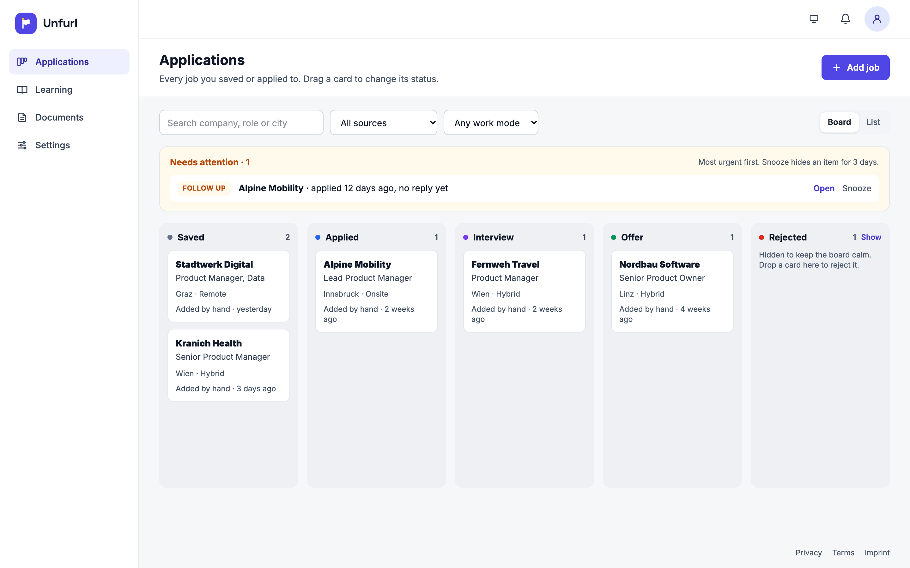
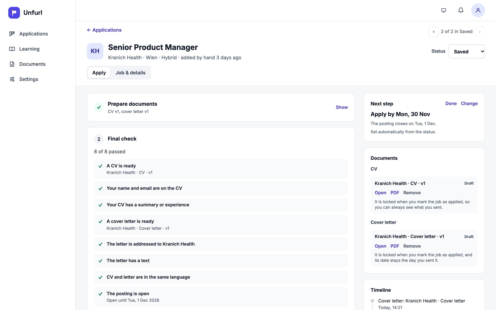
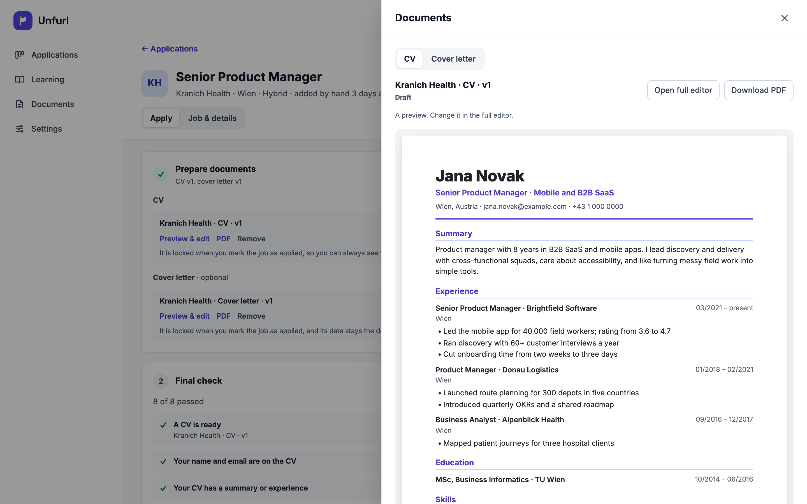
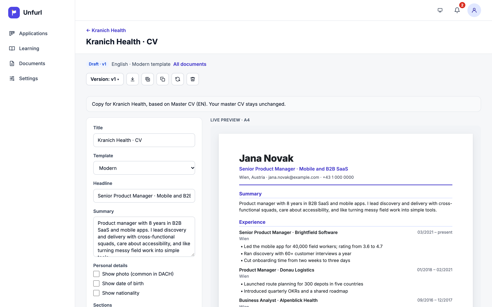
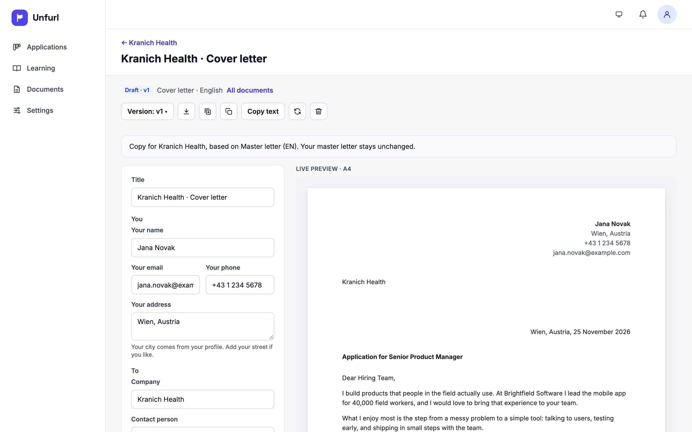
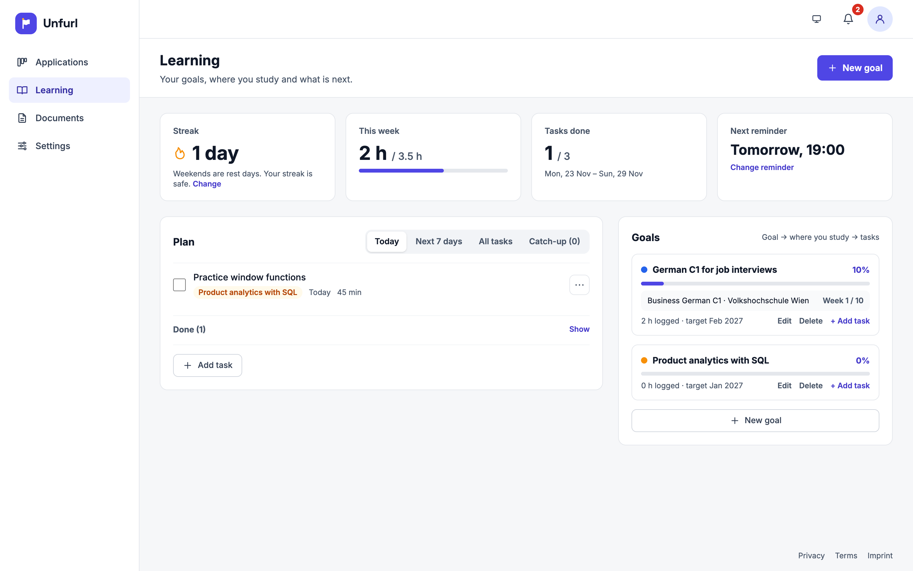
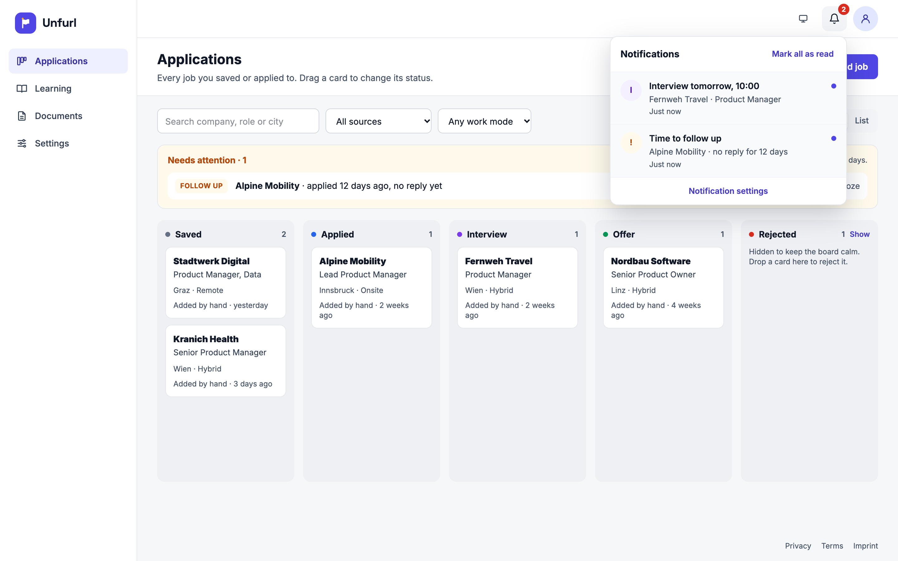
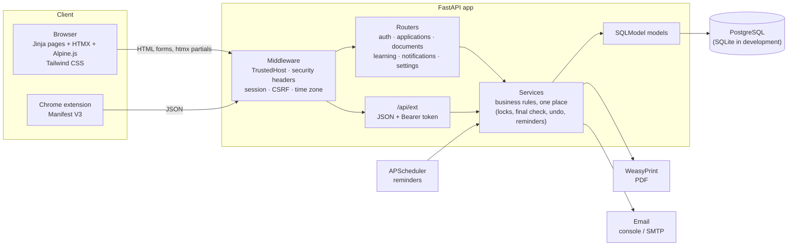

# Unfurl

[](https://github.com/fatihfindik/unfurl/actions/workflows/ci.yml)


**Grow while you apply.** A web app and Chrome extension for job seekers: CVs and cover
letters in German, English and Turkish, an application board, a final check before you
send, and a learning plan for the skills a job asks for.



> **Status:** the MVP is complete and runs as a personal local instance; there is no hosted
> demo (D-155). It ships **without AI** (D-150): the AI features (job extraction, fit
> analysis, an assistant on the Claude API) are designed in the [SPEC](docs/SPEC.md) and
> come in V2.

## What it does

- **CVs and cover letters** in DE / EN / TR, edited with a live A4 preview and downloaded
  as PDF (3 CV templates). Each language has a master; every job gets its own copy, so
  the master stays clean.
- **What you sent stays as you sent it.** When a job is marked as applied, the CV and
  letter linked to it are locked. Changes after that make a new version.
- **Applications board** (Saved → Applied → Interview → Offer → Rejected) with drag and
  drop, a list view, search and filters, archive, and Undo for every delete or move.
- **Apply flow:** prepare the documents, then a final check (name and email on the CV,
  letter addressed to the company, same language, posting still open…) before you
  mark the job as applied.
- **Needs attention and next steps:** follow-ups after 10 days without a reply,
  interviews, deadlines, all computed from the application's status.
- **Chrome extension:** save the job ad you are looking at to the board in one click
  (schema.org `JobPosting`, site readers, or the page title as a fallback).
- **Learning:** goals, where you study, tasks, weekly hours and a streak with rest days.
- **Notifications** in the app and by email, in each user's time zone, on a scheduler.
- **Your data is yours:** export everything as JSON, or delete the account (GDPR).

## Screenshots

| | |
|---|---|
|  **Apply › Final check** |  **Documents drawer** |
|  **CV editor** |  **Cover letter editor** |
|  **Learning** |  **Notifications** |

All screenshots show a fictional demo account (`scripts/seed_demo.py`), not real data.

## Architecture



- **Server-rendered HTML.** Pages are Jinja templates; HTMX swaps small parts of a page
  (a card, a panel, a toast with Undo) without a JavaScript framework. Alpine.js handles
  the little local state (menus, dialogs).
- **Thin routers, services hold the rules.** A router reads the request and picks a
  template; services decide (who owns this, is it locked, what is the next step). Every
  query on user data filters by `user_id`.
- **One database layer for both engines:** SQLModel with Alembic migrations, SQLite for
  development and PostgreSQL in Docker; CI adds PostgreSQL tests and a Docker smoke
  test on every pull request.
- **The extension** talks to a small JSON API with a revocable Bearer token; it never
  reads cookies and runs only when clicked.
- **Personal instance:** Docker Compose (app + Postgres 16) on `127.0.0.1:8100`, with
  backup and restore scripts.

**Stack:** Python 3.12 · FastAPI · SQLModel · Alembic · HTMX · Alpine.js · Tailwind CSS ·
PostgreSQL · WeasyPrint · APScheduler · Chrome Extension (Manifest V3) · Anthropic
Claude API (V2)

## How it was built

Built by **Fatih Findik** (product owner) with **Claude Code**. I wrote and decided the
product; Claude Code wrote most of the code under a fixed process:

1. **Spec first.** [`docs/SPEC.md`](docs/SPEC.md) is the single source of truth, with a
   clickable [prototype](docs/prototype/) as the design reference.
2. **Every milestone** goes plan → review → code → tests → manual test → PR
   ([`docs/WORKFLOW.md`](docs/WORKFLOW.md)). Plans live in [`docs/plans/`](docs/plans/) and
   are checked by a `plan-reviewer` subagent against the SPEC before I approve them; a
   `test-writer` adds authorization and error-case tests, and a `security-reviewer`
   checks the branch before merge.
3. **Decisions are written down:** 170+ entries in [`docs/DECISIONS.md`](docs/DECISIONS.md),
   each with the reason and the alternatives.
4. **Tests:** about 4,000 pytest tests on every push, plus PostgreSQL and Docker checks
   on pull requests; tests never call a real AI API.

## What I learned

I started this project while learning Python. A few things from
[`docs/LEARNING_LOG.md`](docs/LEARNING_LOG.md), which has the full notes per milestone:

- **A spec that looks clear is not always ready.** A second review of the auth plan found
  eight open questions (open redirects, login lockout, session invalidation). The one who
  writes a plan should not be the only one who checks it.
- **Different checks catch different risks.** With every test green, my own manual test
  still found UI problems, and only the Docker run showed that the app ignored the
  shutdown signal.
- **Security is mostly small details:** a new session on login, only local paths in
  `next=`, the same answer for unknown emails, CSRF tokens on every form, and a
  `user_id` filter on every query.
- **The repo is the source of truth.** SPEC says *what*, DECISIONS says *why*, a plan says
  *how* for one milestone. Changing a rule means changing the SPEC in the same PR.
- **Data you sent must not change.** Locking sent documents and making new versions
  instead of editing them shaped the whole document model.
- **Undo instead of "Are you sure?"** Soft deletes with a short Undo window are kinder
  to users and easier to test than confirmation dialogs.
- **Time is a dependency.** A single `clock` module and per-user time zones made
  reminders, streaks and "applied 12 days ago" testable.
- **Small steps work better.** One step, one commit, the app runnable after each one;
  that was easier to follow than long sessions with many terminal tabs.

## Run it yourself

You need [uv](https://docs.astral.sh/uv/), git and Pango (`brew install pango` on a Mac;
without it, PDF downloads fail).

```bash
git clone https://github.com/fatihfindik/unfurl.git
cd unfurl
uv sync                          # Python 3.12 + dependencies
cp .env.example .env             # local settings
scripts/build_css.sh             # Tailwind CSS
uv run alembic upgrade head      # SQLite database
uv run fastapi dev app/main.py   # http://localhost:8000
```

Emails are printed in the terminal, so copy the verification link from there. Run the
tests with `uv run pytest`.

**With demo data:** the screenshots come from a separate demo database.

```bash
DATABASE_URL=sqlite:///./demo.db uv run alembic upgrade head
DATABASE_URL=sqlite:///./demo.db uv run python scripts/seed_demo.py   # prints the password
DATABASE_URL=sqlite:///./demo.db uv run fastapi dev app/main.py --port 8001
```

**For real use (personal instance, Docker):**

```bash
cp .env.personal.example .env.personal   # fill in the keys (commands are in the file)
scripts/start_personal.sh                # http://127.0.0.1:8100
```

Back up with `scripts/backup_personal.sh` and keep `.env.personal` safe. The data volumes
are external, so Compose can't delete them, but `docker volume rm` or a prune still can.

Everything else (Docker for development, the extension, limits, emails, production
checks) is in [`docs/DEVELOPMENT.md`](docs/DEVELOPMENT.md).

## Roadmap

- **V2:** AI job extraction and fit analysis, AI help in the extension, an assistant
  that edits documents (with a preview before more than two changes), all on the Claude
  API and designed in the SPEC.
- **Deploy:** a hosted version later (M13c). Today the rate limits are in memory and
  meant for a single instance.

## Docs

[SPEC](docs/SPEC.md) · [Decisions](docs/DECISIONS.md) · [Workflow](docs/WORKFLOW.md) ·
[Development](docs/DEVELOPMENT.md) · [Learning log](docs/LEARNING_LOG.md) ·
[Plans](docs/plans/) · [Prototype](docs/prototype/) · [Extension](extension/README.md)

## License

No license: all rights reserved. You are welcome to read the code.
